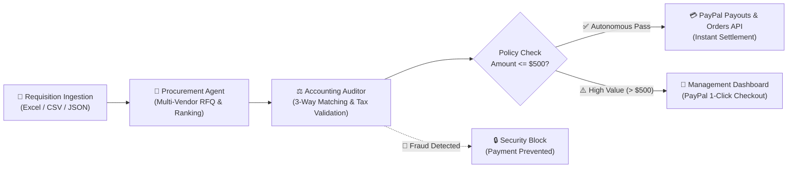

# 🤖 ProcurePay AI
### Autonomous B2B Procurement, 3-Way Invoice Audit & Instant PayPal Settlement
**Submission for PayPal AI Hackathon 2026 (Devpost)**

---

## 💡 Inspiration & The Problem
In modern enterprise operations, the procurement-to-pay (P2P) lifecycle is plagued by friction, human delays, and compliance risks:
* **Manual Quotation Analysis:** Procurement teams spend days contacting suppliers and manually comparing quotes across spreadsheets.
* **Invoice Fraud & Discrepancies:** 15% of supplier invoices contain price surges, unapproved line items, or tax calculation errors.
* **Slow Supplier Settlement:** Payment delays strain supply chains and damage vendor relationships.

**ProcurePay AI** solves this by introducing a sovereign squad of cognitive agents that automate the entire journey from requisition to PayPal settlement in seconds, with zero data leakage and human-in-the-loop oversight.

---

## ⚡ What it Does (End-to-End Workflow)



1. **Intelligent Ingestion:** Ingests purchase requisitions from Excel (`.xlsx`), CSV, JSON or drag-and-drop web UI.
2. **Cognitive RFQ & Supplier Scoring:** Generates multi-vendor quote matrices, ranking suppliers on cost (60%), delivery SLA (25%) and reputation (15%).
3. **3-Way Matching & Tax Audit:** Matches PO vs Approved Quote vs Incoming Invoice (unit prices, 16% tax integrity, unapproved items).
4. **Autonomous PayPal Settlement Gateway:**
   * **Under $500 USD:** Triggers autonomous zero-touch payout via **PayPal Payouts API** and creates tracking order in **PayPal Orders API**.
   * **Over $500 USD:** Generates a **PayPal Smart Checkout** link for 1-click supervisory approval (*Human-in-the-Loop*).
   * **Audit Discrepancies:** Stops disbursement immediately, generating an audit discrepancy report.

---

## 🛠️ Tech Stack & Integrations

* **Payment & Settlement Engine:** PayPal Developer Platform (Sandbox Orders v2 API, Payouts v1 API, OAuth2 Bearer Authentication).
* **UI & Data Presentation:** React / Vanilla JS with **AG Grid Alpine Dark** for multi-vendor quotation matrices and audit grids *(Eligible for AG Grid Partner Award)*.
* **Backend Microservice:** Python 3.14, FastAPI, Pydantic, Pandas, OpenPyXL, Uvicorn.
* **AI & LLM Orchestration:** Groq (Llama 3.3 70B), OpenRouter cognitive parser with structured JSON output.

---

## 🚀 Quickstart & Running Locally

### 1. Clone & Configure Environment
```bash
git clone https://github.com/your-username/procurepay-ai.git
cd procurepay-ai

# Configure .env with your PayPal Sandbox credentials
cp .env.example .env
```

### 2. Install Dependencies
```bash
pip install -r requirements.txt
```

### 3. Start the Server
```bash
python3 -m uvicorn backend.server:app --host 0.0.0.0 --port 8000 --reload
```

### 4. Open Dashboard
Navigate to `http://localhost:8000` in your web browser.

---

## 🧪 Preset Demo Scenarios (1-Click Evaluation)

The web dashboard comes pre-loaded with 3 instant demonstration scenarios:
1. **Scenario 1: Autonomous Pass (< $500 USD):** Industrial valves requisition ($446.60 USD) processed and autonomously settled to the vendor via PayPal Sandbox.
2. **Scenario 2: High-Value Approval (> $500 USD):** Siemens PLC automation equipment ($1,484.80 USD) audited and held for 1-click supervisor PayPal approval.
3. **Scenario 3: Discrepancy / Fraud Detection:** Detects vendor mismatch, unauthorized line item and price surge (+35%), locking the payment and generating a security alert.

---

## 🏆 Partner Technologies Used
* **PayPal:** Core payment rail (Orders API + Payouts API).
* **AG Grid:** Enterprise table rendering for quote comparison and line-item audits.
